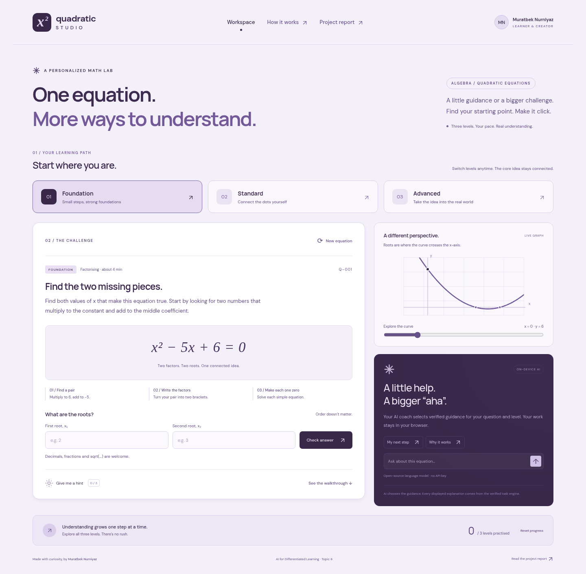

# Quadratic Studio

**Moldash Bekarys · Topic 8: AI for Differentiated Learning**

A responsive, interactive learning lab that transforms one quadratic-equations concept into Foundation, Standard and Advanced challenges. Includes 24 verified tasks, three hints per task, worked solutions, arithmetic-aware answer checking, an interactive graph and a real, on-device language-model integration.



## Run locally

Use Node.js 22 LTS (see `.nvmrc`) or Node.js 24, and npm 10 or 11.

```sh
npm ci
npm run dev
```

Open the address printed by Vite. No environment variables, account, database or API key are required. `.npmrc` tells ONNX Runtime to skip its unused Node/CUDA download; this application uses browser WASM. npm 11 may warn about this supported dependency-specific flag. If your npm version does not propagate it, set `ONNXRUNTIME_NODE_INSTALL_CUDA=skip` for `npm ci` instead.

For the submission build:

```sh
npm test
npm run build
npm run preview
```

The `dist/` directory is the complete deployable website. Serve it over HTTP locally or HTTPS in production; do not open `index.html` with `file://` because module workers require an HTTP origin. Vite's relative asset paths support project subdirectories such as GitHub Pages.

## What to try

1. In **Foundation**, solve `x² − 5x + 6 = 0`. Submit `2` and `3` in either order. Reveal the three hints and complete walkthrough.
2. Switch to **Standard** without changing the seed. Solve `2x² − 10x + 9 = 0`. Enter `(5-sqrt(7))/2` and `(5+sqrt(7))/2`, or `1.18` and `3.82`.
3. In **Advanced**, the same seed creates `h(t) = −5t² + 25t + 30`. Enter landing time `6` seconds and maximum height `61.25` metres. The negative root `−1` is rejected as physically inadmissible.
4. Move the graph slider, request AI help, generate another equation, and reload to confirm locally saved progress. Progress records correctly completed levels on this device.

## How differentiation works

The shared seed is a pair of positive integers `p, q`, with sum `S = p + q` and product `P = pq`.

| Level | Transformation | Scaffolding and expected reasoning |
| --- | --- | --- |
| Foundation | `x² − Sx + P = 0` | Integer factor pairs, explicit three-step scaffold, direct progressive hints, zero-product property. |
| Standard | `2x² − 2Sx + (2P − 3) = 0` | Non-monic quadratic with irrational roots; identify coefficients, calculate the discriminant, use both signs in the formula. |
| Advanced | `h(t) = −5t² + 5St + 5P` | Interpret units and `t ≥ 0`; discard negative time, find the vertex and evaluate maximum height. |

Changing levels preserves the seed; **New equation** cycles eight seeds. The levels change the mathematics, conceptual demand and amount of guidance, rather than merely changing labels. This is learner-controlled differentiation, not a claim to diagnose ability automatically.

## Actual AI integration

`src/ai.worker.js` uses **Transformers.js 3.8.1** to run the open-source **HuggingFaceTB/SmolLM2-135M-Instruct** model with **q4 quantisation and ONNX WASM** in a background Web Worker. The model is loaded only on the first coach request. Model downloads can take several minutes; subsequent use may benefit from browser caching. Current desktop browsers work best; memory limits, private-browsing restrictions or blocked model hosts can prevent inference.

The prompt is assembled in `src/math.js::aiPrompt`. It contains the current equation, learner level, question and four verified guidance cards: a next step, why the method works, checking an answer, and a deeper connection. Last-check feedback and the number of hints used personalise the cards. Final results appear only if the walkthrough is open. The model dynamically selects the most useful card; the deterministic engine transforms task parameters, provides all displayed mathematics and checks answers. This is constrained AI-assisted guidance, not free-form mathematical generation.

Example system prompt, abridged:

> Select the most useful VERIFIED guidance card for the learner. [Level-specific style.] Output exactly one letter: A, B, C or D. A = next step; B = why the method works; C = checking an answer; D = a deeper connection. Do not generate mathematics or prose.

Foundation prioritises direct scaffolding and a small next step; Standard supports independent reasoning about coefficients, the discriminant and formula; Advanced supports units, physical-domain interpretation and multi-step reasoning. A custom logits processor preserves the language model’s relative scores for the four label tokens and masks every other token. It generates exactly one label. The displayed explanation is the corresponding verified card, not unrestricted model prose. See [the complete prompt source](src/math.js) for the exact implementation.

### Privacy, keys and limitations

- No external AI API is called and no API key is embedded in the client. The permitted open-source-model route replaces an API backend/key configuration.
- Questions and answers remain on the device; model files are downloaded from Hugging Face. The host receives ordinary download requests, not the learner's prompt. The website has no analytics or student-upload endpoint.
- Only level, seed and completed-level progress are stored in localStorage. Answer drafts remain in memory. **Reset progress** clears completion progress.
- A language model can choose a less relevant card, but it cannot invent displayed mathematical claims: decoding permits only A/B/C/D, and the app displays only the corresponding verified card. Card titles make the selected strategy visible; all four strategies remain mathematically valid for the current task. Initial free-form model responses were rejected after they produced incorrect mathematics in a real browser test.
- If model loading fails, the app clearly says **AI unavailable** and labels its fallback **Verified guidance (not AI-generated)**. A fallback is never presented as successful inference. AI requests can be cancelled; changing tasks cancels an in-flight request to prevent stale replies.
- Initial model access needs `huggingface.co` and its model-artifact/CDN hosts. The application does not need a public backend or server-held credentials.

## Verification

```sh
npm test
```

The ten Node test groups cover all 24 tasks: root substitution, Vieta's relations, exact radicals, rounded values, negative-time rejection, the vertex maximum, swapped answers, incorrect inputs, safe parsing differentiated prompt context, complete guidance cards and output-mask integrity. A small recursive-descent parser supports fractions and `sqrt(…)`; it never evaluates JavaScript. Answers are accepted within an absolute tolerance of `0.01`.

The optional functional browser checks use Python Playwright and an installed Chromium:

```sh
python3 -m pip install playwright
npm run build
npm run preview -- --port 4173
# In a second terminal:
BROWSER_EXECUTABLE=/path/to/chromium python3 tests/browser.py
```

The checks exercise the real production page: three levels, input validation, exact-root submission, physical interpretation, hints, solutions, keyboard navigation, graph updates, local progress, dialog behaviour, report download, responsive layouts and an intentionally denied model-download fallback. Screenshots and results go to ignored `test-results/`. **These browser checks do not claim to test successful language-model inference.** See `SUBMISSION.md` for the current deployment/inference status.

`tests/live_ai.py` is a separate real-model integration test. It starts the production server, downloads the actual model in Chromium and requests a response on all three levels. The `ai-browser-check` GitHub Actions job runs it and publishes the selected strategy and verified text for review. A successful result must be labelled `source: model-selected`, with a valid strategy A/B/C/D, never `verified-fallback`. This proves real model inference and constrained guidance selection, not free-form generation.

## Deploy

### GitHub Pages

1. Publish the source to the selected `johndoe018/bekarys1` repository on `main`.
2. In the repository, choose **Settings → Pages → Source → GitHub Actions**. Repository visibility should be public for the assignment.
3. The included `.github/workflows/pages.yml` installs dependencies, runs the math tests, builds and deploys the website on pushes to `main` (or a manual workflow run).
4. Use the URL returned by the successful deployment job; verify it in a fresh browser and complete one task per level plus a real AI coach request before submitting.

### Netlify alternative

Import the public repository with build command `npm run build` and publish directory `dist`. `netlify.toml` includes these settings. Alternatively upload the contents of an already built `dist` directory through Netlify's manual deploy UI. Use the actual URL Netlify returns; no deployment URL is invented in this project.

## Submission files

- `public/report.pdf`: the one-page project report, also linked from the application.
- `docs/report.md`: editable report text.
- `SUBMISSION.md`: deliverables, tested capabilities and outstanding publication requirements.
- `src/`, `index.html`, `tests/`, `package.json`, `package-lock.json`: original project source and reproducible dependencies.

The deliverable was prepared with AI development assistance. Moldash Bekarys is the project owner named by the requester; this does not imply unaided student authorship. Review the code, prompts and report and follow the course's disclosure rules when submitting.

## Technology references

- [Transformers.js documentation](https://huggingface.co/docs/transformers.js)
- [Open-source model and model card](https://huggingface.co/HuggingFaceTB/SmolLM2-135M-Instruct)
- [Vite deployment documentation](https://vite.dev/guide/static-deploy.html)
- [GitHub Pages with Actions](https://docs.github.com/en/pages/getting-started-with-github-pages/using-custom-workflows-with-github-pages)

The interface, task engine, prompts and report are project-specific. Framework, runtime, font and model components remain subject to their respective upstream licences.
